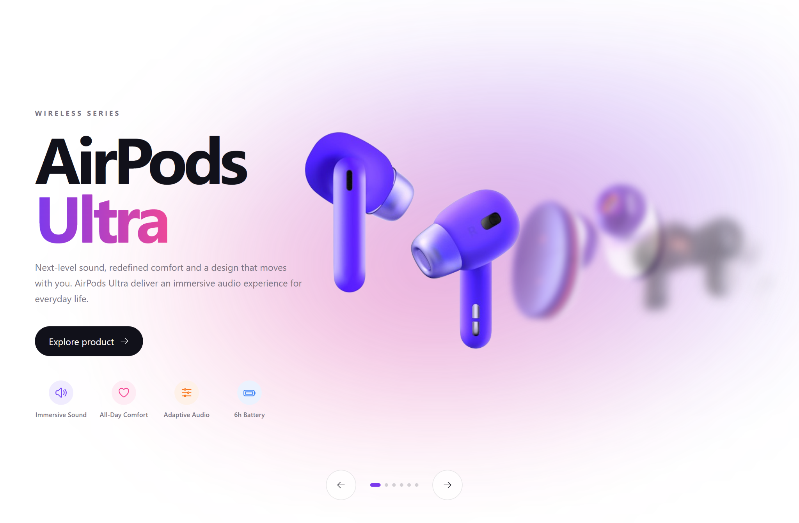

# AirPods Slider

An interactive AirPods concept slider built as a frontend showcase project.

The experience combines fluid product transitions, responsive layouts and detailed product views in a clean, Apple-inspired interface.



> This is an independent concept project created for educational and portfolio purposes. It is not affiliated with, endorsed by, or associated with Apple Inc. Product names, variants and specifications shown in the project are fictional.

## Live Demo

https://mirekzverina-airpods-slider.netlify.app/

## Features

- Interactive six-product slider
- Fluid animations powered by Motion
- Individual product detail views
- Animated product transitions and background glows
- Responsive design for desktop, tablet and mobile
- Product thumbnails and navigation controls
- Reduced-motion support
- Keyboard focus states and accessible controls
- Open Graph metadata for social sharing

## Tech Stack

- React
- TypeScript
- Vite
- SCSS
- Motion
- React Icons

## Getting Started

Clone the repository and install the dependencies:

```bash
npm install
```

Start the development server:

```bash
npm run dev
```

Create a production build:

```bash
npm run build
```

Run ESLint:

```bash
npm run lint
```

## Project Structure

```text
src/
├── assets/
│   └── images/
│       └── products/
├── components/
│   ├── ProductDetail/
│   ├── ProductSlider/
│   └── TechStack/
├── data/
│   └── products.ts
├── types/
│   └── product.ts
├── App.tsx
├── index.scss
└── main.tsx
```

## Design

The project focuses on a minimal product-showcase experience with:

- layered product imagery
- dynamic accent colors and ambient glows
- typography-led layouts
- responsive product presentations
- subtle motion and depth

Each product uses its own visual identity while sharing the same component architecture.

## Accessibility

The interface includes keyboard-accessible controls, visible focus states, semantic button labels, live product announcements and support for the user's reduced-motion preference.

## Author

**Mirek Zvěřina**  
Full-Stack Developer

Portfolio: https://mirekzverina.netlify.app/  
GitHub: https://github.com/mirekzverina  
LinkedIn: https://linkedin.com/in/mirekzverina
